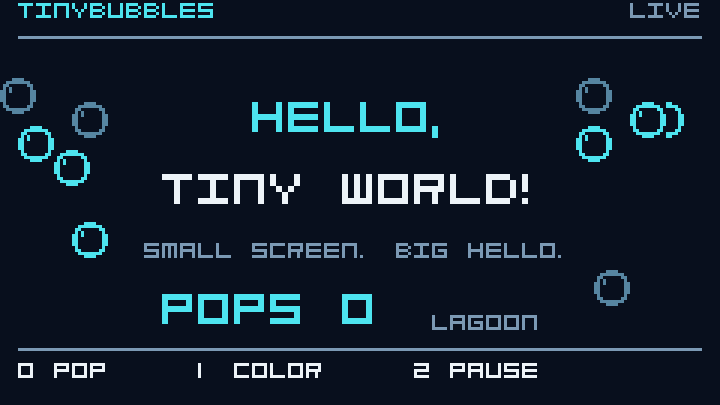

# TinyBubbles - TinyGo Display UIs

<p>
    <a href="https://github.com/NimbleTerminal/TinyBubbles/actions/workflows/ci.yml"></a>
    <a href="https://pkg.go.dev/github.com/NimbleTerminal/TinyBubbles"></a>
    <a href="https://tinygo.org"></a>
    <a href="./LICENSE"></a>
</p>

`TinyBubbles` brings the [Bubble Tea](https://github.com/charmbracelet/bubbletea)
Model / Update / View pattern to [TinyGo](https://tinygo.org) embedded displays.

Small screens, big possibilities!

<p align="center">
    <a href="./devices/feather-reverse-tft/README.md"><b>Hello, Tiny World</b></a>
    (<a href="./demo/hello/model.go">source</a>)<br>
    <a href="./devices/feather-reverse-tft/README.md"></a>
</p>

The preview renders the actual demo model and font on the desktop, enlarged 3×.
The demo also runs on the **Adafruit ESP32-S3 Reverse TFT Feather**: D0 pops bubbles,
D1 changes colors, and D2 pauses or resumes animation.

```go
import bubbles "github.com/NimbleTerminal/TinyBubbles"
```

Views produce character grids that render through
[`drivers.Displayer`](https://github.com/tinygo-org/drivers/blob/v0.36.0/displayer.go).
Initialize your display and buttons in a device entry point, then pass them into
one program. The core has no terminal, ANSI, OS, or board-specific imports.

| Component | Description |
| :--- | :--- |
| [Program](./API.md#model-commands-and-a-ready-display) | Model / Update / View with messages, commands, and a cooperative event loop. |
| [Cell buffer](./cell.go) | Reusable character grids with UTF-8 text, newlines, and clipped writes. |
| [Renderer](./API.md#displayer-and-rendering) | Changed-cell drawing through Displayer, with optional `FillRectangle` acceleration. |
| [Fonts and themes](./API.md#fonts-and-themes) | TinyFont or custom glyphs, a compact style palette, and monochrome/color defaults. |
| [Input](./input.go) | Standard directional, Select, Back, and Quit events, plus debounced buttons and custom messages. |
| [Devices](./DEVICES.md) | Separate entry points for concrete displays, buttons, buses, and power controls. |

See the [API guide](./API.md), [device guide](./DEVICES.md), and
[hello demo instructions](./devices/feather-reverse-tft/README.md).

## Quickstart

Requires **TinyGo v0.43.0 or newer** and a Go installation supported by your
TinyGo compiler. Ordinary Go can run the tests and desktop previews.

From a checkout:

```sh
make hello-preview  # build/hello.png and build/hello.gif
make hello          # build/feather-reverse-tft.bin
```

Follow the [Feather flashing instructions](./devices/feather-reverse-tft/README.md#flash)
to run the demo on hardware. For an SSD1306 connected to a Pico:

```sh
tinygo flash -target=pico ./devices/pico-oled
```

The [device guide](./DEVICES.md) covers wiring and adding a board.

## Usage

Implement the model interface:

```go
type Model interface {
    Init() Cmd
    Update(Msg) (Model, Cmd)
    View() *Buffer
}
```

`Update` handles button events or your own messages. `View` fills a reusable
buffer. `Cmd` performs short work and returns a message to the model.

The [counter model](./demo/model.go) runs on both the Pico OLED and CLUE TFT.
After initializing a display and a nonblocking input function in your device's
`main`, pass them into a program:

```go
// Imports:
// bubbles "github.com/NimbleTerminal/TinyBubbles"
// "github.com/NimbleTerminal/TinyBubbles/demo"

p, err := bubbles.NewProgram(demo.New(), bubbles.Config{
    Display:    display, // initialized drivers.Displayer
    Monochrome: true,    // false for a color display
    Input:      poll,    // func() bubbles.Msg; nil when idle
})
if err != nil {
    panic(err)
}
if err := p.Run(); err != nil {
    panic(err)
}
```

The framework sends `WindowSizeMsg` before the first view so your model can adapt
its layout. `Run` polls input and processes one command per step; use `Step` to
integrate with your own device loop. Commands execute cooperatively without
framework-created goroutines, and must not block on input, timers, or network
responses. The [API guide](./API.md) includes a complete model, lifecycle details,
error handling, and command-queue limits.

## Demo Apps

| Demo | Source | What it shows |
| :--- | :--- | :--- |
| Hello, Tiny World | [demo/hello](./demo/hello) | Floating bubbles, large text and counter, four palettes, and pause/resume on the Reverse TFT Feather. |
| Counter | [demo](./demo/model.go) | One model adapting to a monochrome OLED or color TFT. |
| Hello preview | [examples/hello-preview](./examples/hello-preview) | The hello demo rendered to PNG and an animated GIF with ordinary Go. |
| Counter snapshot | [examples/snapshot](./examples/snapshot) | A desktop Displayer implementation that writes a PNG. |

## Device Support

| Device | Display | TinyGo target | Validation |
| :--- | :--- | :--- | :--- |
| Adafruit Reverse TFT Feather | ST7789, 240×135 | [Local target](./devices/feather-reverse-tft/target.json) | Demo confirmed on hardware |
| Raspberry Pi Pico | SSD1306, 128×64 | `pico` | Compiled |
| Raspberry Pi Pico 2 | SSD1306, 128×64 | `pico2` | Compiled |
| Adafruit CLUE | ST7789, 240×240 | `clue` | Compiled |

The core also has an ESP32-S3 compile check. Other boards can use any initialized
`drivers.Displayer`; concrete peripherals stay under `devices/<name>/main.go`.
See [adding a device](./DEVICES.md#devices-and-wiring).

The default font uses 6×8 pixel cells. Two cell grids take about **2.6 KiB** on a
128×64 OLED, **10 KiB** on a 240×135 TFT, or **24.8 KiB** on a 320×240 display.
TinyBubbles allocates no pixel framebuffer; drivers may maintain their own.
See [memory and resolution](./API.md#memory-and-resolution) for the full budget.

## Development

| Command | Purpose |
| :--- | :--- |
| `make check` | Check formatting, module consistency, local documentation links, race tests, vet, and host builds. |
| `make test` | Run race-enabled Go tests with coverage and vet. |
| `make firmware` | Compile all device examples and the ESP32-S3 core check. |
| `make hello` | Build the Reverse TFT Feather firmware. |
| `make hello-preview` | Generate the hello PNG and animated GIF in `build/`. |
| `make snapshot` | Render the counter to `snapshot.png`. |

[GitHub Actions](https://github.com/NimbleTerminal/TinyBubbles/actions/workflows/ci.yml)
runs on every push and pull request, and supports manual dispatch. The host job
runs `make check` and generates both desktop previews. The firmware job builds
Pico, Pico 2, CLUE, the ESP32-S3 core check, and the Reverse TFT Feather with
**TinyGo v0.43.0**. Successful jobs upload firmware and preview artifacts for
14 days. CI validates builds; it does not flash connected hardware or publish
releases. `make check` also requires Python 3 for local documentation checks.

The module declares Go 1.23 language compatibility and pins drivers v0.36.0 and
TinyFont v0.7.0. TinyBubbles uses the TEA architecture but does not depend on
Bubble Tea or accept ANSI views. To port a terminal model, use buffer writes and
palette styles in `View`; see the [rendering guide](./API.md#displayer-and-rendering).

To refresh the README animation after a demo change:

```sh
make hello-preview
cp build/hello.gif docs/assets/hello.gif
```

## TODO

The next milestone is a **three-button settings menu on the Feather** with
scrolling options, editable values, and a confirmation dialog.

- [ ] **Widgets and layout:** scrolling menu, progress bar, label, and dialog;
  add buffer composition and alignment helpers.
- [ ] **Button interactions:** optional hold-to-repeat, long-press, and release
  events, suitable for devices with only a few buttons.
- [ ] **Cooperative timers:** reusable ticks and delayed messages with cancellation,
  keeping commands short and avoiding application-specific scheduling boilerplate.
- [ ] **Interactive desktop simulator:** keyboard-controlled display with OLED and
  TFT presets for testing navigation and layouts without flashing.
- [ ] **Rendering benchmarks:** measure frame time, allocations, and display writes
  on the Feather; use the results to evaluate glyph caching and batched transfers.
- [ ] **OLED hardware validation:** verify the Pico SSD1306 example on a physical
  display, including monochrome styling and button navigation.
- [ ] **First release:** validate CI on the new repository, document any remaining
  API limitations, and publish an initial version.
- [x] **Canonical repository:** align module imports, links, and the remote with
  `NimbleTerminal/TinyBubbles`.

## Open Collaboration

We welcome contributions and feedback! Run `make check` before submitting changes,
and `make firmware` when changing the core or device setup. Include your board,
display, TinyGo version, and reproduction steps when reporting hardware issues.

- [GitHub Issues](https://github.com/NimbleTerminal/TinyBubbles/issues)
- [GitHub Pull Requests](https://github.com/NimbleTerminal/TinyBubbles/pulls)

## Acknowledgements

Thanks to [Charm.sh](https://charm.sh) for sharing
[Bubble Tea](https://github.com/charmbracelet/bubbletea) and its approach to building UIs.
Thanks to the [TinyGo](https://tinygo.org) community for the compiler,
[drivers](https://github.com/tinygo-org/drivers), and
[TinyFont](https://github.com/tinygo-org/tinyfont).

Thanks also to tinyterm, tinypod, and tinygui for exploring embedded display
rendering, device configuration, and UI design. TinyBubbles brings those concerns
together around a reusable Model / Update / View framework.

## License

This project is released under the **MIT License**, see [LICENSE](./LICENSE).
Third-party dependencies and font faces retain their respective licenses.

Copyright (c) 2026 [Neomantra Corp](https://www.neomantra.com).

----

Made with :heart: and :fire: by the team behind [NimbleTerminal](https://NimbleTerminal.com).
