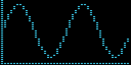
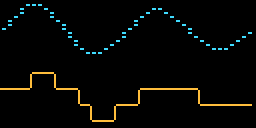
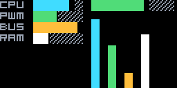
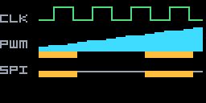

# `tinycharts`: Embedded & Cell-Buffer Charts for TinyBubbles

[Back to the README](../README.md) · [Layout](../layout/README.md) · [Widgets](../widgets/README.md) · [TinyHAL](../tinyhal/README.md)

`nimbleterminal.dev/tinybubbles/tinycharts` provides allocation-conscious chart
widgets for TinyBubbles [`*bubbles.Buffer`](../cell.go) grids and embedded
displays, modeled after [`NimbleMarkets/ntcharts`](https://github.com/NimbleMarkets/ntcharts).

| Chart | Preview | Purpose |
| --- | --- | --- |
| [BrailleGrid](#braillegrid) |  | Plot lines on a 2×4 sub-cell dot matrix. |
| [Sparkline](#sparkline) |  | Scroll recent values as fractional block columns. |
| [Streamline](#streamline) |  | Scroll a time series as a Braille, arc, or box line. |
| [BarChart](#barchart) |  | Compare labeled values horizontally or vertically, or draw a one-row gauge. |
| [LogicChart](#logicchart) |  | Show digital, PWM, and bus traces as logic analyzer lanes. |

The screenshots use the default 6×8 font on a 128×64 display, enlarged twice.
Regenerate them with `make tinycharts-preview` after changing chart rendering.

## Procedural Unicode Chart Runes in `DefaultFont()`

TinyBubbles' [`TinyFont`](../font.go) procedurally rasterizes three standard
Unicode ranges into any `(Width × Height)` cell without requiring extra bitmap
font tables in Flash or RAM:

| Unicode Range | Runes | Purpose |
| --- | --- | --- |
| **Box & Arc Drawing** (`U+2500..U+257F`) | `─ ━ │ ┃ ┌ ┐ └ ┘ ├ ┤ ┬ ┴ ┼ ╭ ╮ ╯ ╰` | Connected step/wave lines, logic edges, and axes |
| **Block Elements** (`U+2580..U+259F`) | `▀ ▁ ▂ ▃ ▄ ▅ ▆ ▇ █ ▉ ▊ ▋ ▌ ▍ ▎ ▏ ▐ ░ ▒ ▓ ▔ ▕ ▖..▟` | Fractional sparklines, horizontal/vertical bars, and 2×2 quadrant blocks |
| **Braille Patterns** (`U+2800..U+28FF`) | `⠀ .. ⣿` | Sub-cell `2×4` dot matrix plotting inside a single character cell |

Because these runes are standard Unicode codepoints, the exact same chart
buffer renders on an MCU `ST7789` / `SSD1306` display, in the browser WASM
canvas, and in a terminal.

## Chart Types

Every chart draws into a `*bubbles.Buffer` region with `Draw(dst, rect)` or
returns its own buffer from `View()`. Charts allocate at construction and on
`Resize`; pushing values and drawing reuse that storage.

### BrailleGrid

[`runes.go`](./runes.go) · A `2*W × 4*H` sub-cell dot matrix. `Set(dx, dy)`
lights one dot, `DrawLine` plots a Bresenham line, and `Draw(dst, rect, style)`
writes the Braille runes. `DotSize()` reports the plotting resolution for the
current cell size. Use it for custom plots that the other charts do not cover.

### Sparkline

[`sparkline.go`](./sparkline.go) · A scrolling right-to-left column chart using
`▁▂▃▄▅▆▇█`. `Push` and `PushAll` add samples and drop the oldest when full.
`WithSparklineMax` fixes the scale; `WithSparklineAutoMax` grows it with the data.
`WithSparklineStyle` picks the theme style for the columns.

### Streamline

[`streamline.go`](./streamline.go) · A scrolling time-series line chart.
`StreamModeBraille` plots a `⠀..⣿` curve at sub-cell resolution; `StreamModeArc`
(`╭╮╰╯─│`) and `StreamModeBox` (`┌┐└┘─│`) connect one rune per column, like the
ntcharts streamline chart. `WithStreamRange` fixes the vertical scale and
`WithStreamAutoRange` tracks the data.

### BarChart

[`barchart.go`](./barchart.go) · Labeled bars, horizontal (`▏▎▍▌▋▊▉█`) by
`WithBarHorizontal(true)` or vertical (`▁▂▃▄▅▆▇█`) otherwise. `SetBars` copies
the `BarData` slice; `WithBarMax` and `SetMax` control the scale. `DrawGauge`
draws a single-row fractional gauge without a chart object.

### LogicChart

[`logicchart.go`](./logicchart.go) · Multi-channel logic analyzer lanes.
`LogicBit` draws a square wave with edges, `LogicPWM` draws an 8-bit duty level
as fractional blocks, and `LogicBus` expands into packet blocks while active.
`PushStep` takes one value per channel and scrolls the oldest step out.

## Quickstart

```go
package main

import (
	bubbles "nimbleterminal.dev/tinybubbles"
	"nimbleterminal.dev/tinybubbles/layout"
	"nimbleterminal.dev/tinybubbles/tinycharts"
)

func drawCharts(dst *bubbles.Buffer) {
	_, h := dst.Size()
	top, bottom := layout.Bounds(dst).Rows(h/2, 1)

	// 1. High-resolution Braille streamline chart.
	stream := tinycharts.NewStreamline(
		top.Width, top.Height,
		tinycharts.WithStreamRange(0, 4095),
		tinycharts.WithStreamMode(tinycharts.StreamModeBraille),
		tinycharts.WithStreamStyle(bubbles.Selected),
	)
	stream.PushAll([]float64{512, 1024, 2048, 3500, 4095, 2800, 1200})
	stream.Draw(dst, top)

	// 2. Multi-channel digital & PWM logic analyzer chart.
	logic := tinycharts.NewLogicChart(bottom.Width, bottom.Height, []tinycharts.LogicChannel{
		{Label: "G13", Kind: tinycharts.LogicBit, Style: bubbles.Normal},
		{Label: "PWM", Kind: tinycharts.LogicPWM, Style: bubbles.Selected},
		{Label: "SPI", Kind: tinycharts.LogicBus, Style: bubbles.Accent},
	})
	logic.PushStep(1, 128, 0)
	logic.PushStep(0, 220, 1)
	logic.Draw(dst, bottom)
}
```

For standalone pixel targets (such as [`tinyhal/workbench`](../tinyhal/workbench)),
[`tinycharts.PaintBuffer(display, px, py, chart.View(), font, theme)`](./runes.go)
renders any chart's `*bubbles.Buffer` directly into a `drivers.Displayer`
framebuffer.
